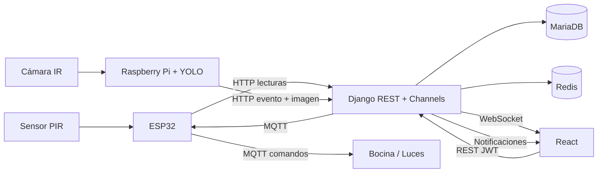

# SIAAC

**Sistema Inteligente de Agricultura Asistida por Computadora**

Plataforma de monitoreo agrícola con visión artificial: un ESP32 captura movimiento
(PIR) y activa la respuesta disuasiva, una Raspberry Pi procesa video con **YOLO** y
el backend en **Django REST Framework** centraliza usuarios, zonas, eventos,
notificaciones y reportes. El frontend en **React** consume la API REST y canales
WebSocket en tiempo real. La base de datos es **MariaDB**, con **tablas en español**.

---

## Arquitectura general



## Estructura del proyecto

```
Procesos_SFTW/
├── backend/                         # Django + DRF + Channels
│   ├── manage.py
│   ├── requirements.txt
│   ├── .env.example
│   ├── config/                      # proyecto Django
│   │   ├── settings/
│   │   │   ├── base.py
│   │   │   ├── development.py
│   │   │   ├── testing.py
│   │   │   └── production.py
│   │   ├── urls.py                  # /api/v1/...
│   │   ├── asgi.py                  # HTTP + WebSocket
│   │   └── wsgi.py
│   ├── apps/
│   │   ├── nucleo/                   # modelos abstractos, permisos, paginación
│   │   ├── autenticacion/            # Módulo 1 · Autenticación y sesión
│   │   ├── cultivos/                 # Módulo 2 · Cultivos y zonas
│   │   ├── monitoreo/                # Módulo 3 · Monitoreo en tiempo real
│   │   ├── reportes/                 # Módulo 4 · Supervisión y reportes
│   │   ├── respuestas/               # Módulo 5 · Respuesta disuasiva
│   │   ├── notificaciones/          # Módulo 6 · Notificaciones
│   │   └── deteccion/                # Detección automática (hardware + IA)
│   ├── ml/yolo/                     # Servicio de inferencia YOLO
│   ├── media/                       # Evidencias y archivos generados
│   └── tests/
├── frontend/                        # React + Vite
│   ├── src/
│   │   ├── api/                     # cliente Axios y endpoints
│   │   ├── components/              # layout y UI reutilizable
│   │   ├── hooks/
│   │   ├── modules/
│   │   │   ├── autenticacion/        # Módulo 1
│   │   │   ├── cultivos/             # Módulo 2
│   │   │   ├── monitoreo/            # Módulo 3
│   │   │   ├── reportes/             # Módulo 4
│   │   │   ├── respuestas/           # Módulo 5
│   │   │   ├── notificaciones/      # Módulo 6
│   │   │   └── deteccion/            # Detección automática
│   │   ├── routes/                  # rutas protegidas
│   │   ├── store/                   # Zustand (sesión)
│   │   └── styles/
│   └── public/
├── database/                        # MariaDB (tablas en español)
│   ├── schema.sql                   # DDL completo + vistas
│   ├── seed.sql                     # datos de ejemplo
│   ├── erd/                         # diagrama entidad-relación
│   └── migrations/
├── hardware/
│   ├── esp32/
│   │   ├── firmware/                # PlatformIO (Arduino/ESP32)
│   │   └── docs/wiring.md           # conexionado y alimentación
│   ├── raspberry_pi/
│   │   ├── services/                # cámara + YOLO + MQTT
│   │   ├── models/                  # pesos .pt
│   │   ├── config/.env.example
│   │   └── README.md
│   └── docs/
├── deploy/nginx/                    # configuración de producción
├── docs/                            # arquitectura, módulos y API
├── docker-compose.yml
├── Makefile
└── README.md
```

## Módulos

| # | Módulo | Backend | Frontend |
| --- | --- | --- | --- |
| 1 | Autenticación y sesión de usuarios | `apps/autenticacion` · JWT + roles + sesiones | `modules/autenticacion` |
| 2 | Gestión de cultivos y zonas | `apps/cultivos` | `modules/cultivos` |
| 3 | Monitoreo en tiempo real | `apps/monitoreo` · WebSocket | `modules/monitoreo` |
| 4 | Supervisión y reportes | `apps/reportes` · PDF/CSV | `modules/reportes` |
| 5 | Configuración y respuesta disuasiva | `apps/respuestas` · MQTT | `modules/respuestas` |
| 6 | Gestión de notificaciones | `apps/notificaciones` · WebSocket | `modules/notificaciones` |
| — | Detección automática (hardware + IA) | `apps/deteccion` · YOLO | `modules/deteccion` |

## Tablas de MariaDB (nombres en español)

| Módulo | Tablas |
| --- | --- |
| 1. Autenticación | `usuarios`, `sesiones_usuario` |
| 2. Cultivos y zonas | `cultivos`, `zonas` |
| 3. Monitoreo | `camaras`, `lecturas_sensor` |
| 4. Reportes | `reportes` |
| 5. Disuasión | `reglas_disuasion`, `activaciones_disuasion` |
| 6. Notificaciones | `notificaciones`, `preferencias_notificacion` |
| Detección | `dispositivos`, `modelos_ia`, `eventos_deteccion` |

> Los nombres de las columnas conservan la convención de Django (inglés) para no
> romper serializers, filtros ni la API. Los `verbose_name` de la interfaz están
> en español.

## Inicio rápido con Docker

```bash
cp backend/.env.example backend/.env
cp frontend/.env.example frontend/.env
docker compose up -d --build

docker compose exec backend python manage.py migrate
docker compose exec backend python manage.py createsuperuser
```

- Frontend: <http://localhost:5173>
- API: <http://localhost:8000/api/v1/>
- Documentación Swagger: <http://localhost:8000/api/docs/>
- Admin Django: <http://localhost:8000/admin/>

## Inicio manual

### Backend

```bash
cd backend
python3.12 -m venv .venv
source .venv/bin/activate
pip install -r requirements.txt
cp .env.example .env           # ajustar credenciales MariaDB
python manage.py migrate
python manage.py createsuperuser
python manage.py runserver 0.0.0.0:8000
```

> Para WebSocket en desarrollo se puede usar `daphne config.asgi:application`
> (o `python manage.py runserver` con `daphne` instalado).

### Frontend

```bash
cd frontend
npm install
cp .env.example .env
npm run dev
```

### Base de datos

```bash
mysql -u root -p < database/schema.sql
mysql -u root -p siaac_db < database/seed.sql
```

Ver `docs/` para la arquitectura, el detalle de cada módulo y la referencia de
la API. El hardware se documenta en `hardware/esp32/docs/wiring.md` y
`hardware/raspberry_pi/README.md`.

## Roles

| Rol | Alcance |
| --- | --- |
| `ADMIN` | Configuración, usuarios, dispositivos, reglas y reportes. |
| `OPERATOR` | Monitoreo, revisión de detecciones y activación disuasiva. |
| `VIEWER` | Consulta de tableros, zonas y reportes. |

## Hardware del prototipo

- ESP32 DevKit + sensor PIR HC-SR501 + bocina/sirena + luz disuasiva.
- Cámara con visión nocturna infrarroja (IR-CUT) conectada a la Raspberry Pi.
- Raspberry Pi 4/5 para captura, inferencia YOLO y envío de eventos.
- Fuente de 12 V con regulador a 5 V, relés y protecciones (ver cableado).

## Seguridad

- JWT con rotación de refresh tokens y lista negra.
- Roles y permisos por módulo.
- API key por dispositivo para los endpoints de ingesta.
- Variables sensibles en `.env` (nunca versionadas).

## Licencia

Uso académico y de prototipo. Ajustar según la institución o el cliente.
