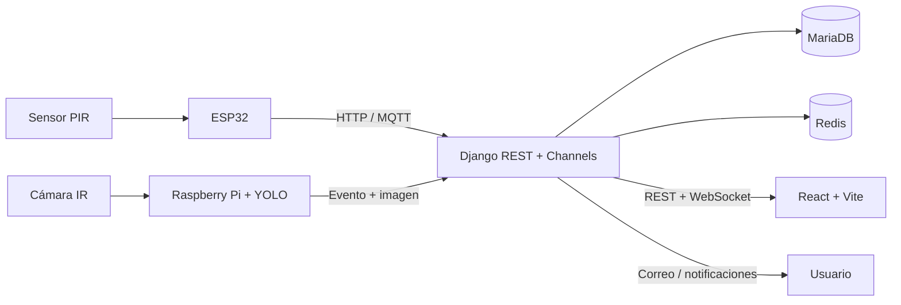

# 🌱 SIAAC

## Sistema Inteligente de Agricultura Asistida por Computadora

SIAAC es una plataforma integral para proteger y supervisar cultivos mediante
sensores, cámaras e inteligencia artificial. El sistema detecta actividad en
las zonas agrícolas, registra eventos, envía notificaciones y permite activar
respuestas disuasivas desde un panel web.

> **Estado:** prototipo funcional en desarrollo  
> **Objetivo:** monitoreo agrícola inteligente, trazable y seguro

### ✨ ¿Qué puede hacer SIAAC?

| 🌾 Agricultura | 🤖 Automatización | 🔐 Seguridad |
| --- | --- | --- |
| Cultivos y zonas | Detección con YOLO | Registro y login |
| Cámaras y sensores | Alertas en tiempo real | Verificación por correo |
| Reportes PDF/CSV | ESP32 y Raspberry Pi | JWT y segundo factor |

## 🖥️ Vista general



## 🧰 Tecnologías

- **Backend:** Python 3.11+, Django 5.2, Django REST Framework, JWT y Channels.
- **Frontend:** React 19, Vite, Zustand, Axios, Recharts y Lucide React.
- **Datos:** MariaDB 11, Redis y archivos multimedia.
- **IA/hardware:** YOLO, OpenCV, ESP32, MQTT y Raspberry Pi.
- **Documentación:** Swagger/OpenAPI.

## 📦 Requisitos para otra máquina

Instalar previamente:

| Herramienta | Versión recomendada |
| --- | --- |
| Git | 2.40+ |
| Python | 3.11 o superior |
| Node.js | 18 LTS o superior |
| npm | 9+ |
| MariaDB | 10.11+ |
| Redis | 7+ |
| Docker Desktop | Opcional, recomendado |

Para el hardware se requiere además PlatformIO, un ESP32, una Raspberry Pi,
una cámara compatible y un broker MQTT.

## 🚀 Instalación rápida con Docker

```bash
git clone <URL_DEL_REPOSITORIO>
cd SIAAC
docker compose up -d --build
docker compose exec backend python manage.py migrate
docker compose exec backend python manage.py createsuperuser
```

Abrir en el navegador:

| Servicio | URL |
| --- | --- |
| Aplicación web | http://localhost:5173 |
| API | http://localhost:8000/api/v1/ |
| Swagger | http://localhost:8000/api/docs/ |
| Admin Django | http://localhost:8000/admin/ |
| Adminer | http://localhost:8081 |

Detener servicios:

```bash
docker compose down
```

> Docker inicia MariaDB, Redis, backend y frontend. Los datos se conservan en
> volúmenes Docker mientras no se eliminen manualmente.

## 🛠️ Instalación manual

### 1. Descargar el proyecto

```bash
git clone <URL_DEL_REPOSITORIO>
cd SIAAC
```

### 2. Preparar MariaDB y Redis

Crear la base de datos y el usuario configurados en `backend/.env`:

```sql
CREATE DATABASE siaac_db CHARACTER SET utf8mb4;
CREATE USER 'siaac_user'@'localhost' IDENTIFIED BY 'siaac_password';
GRANT ALL PRIVILEGES ON siaac_db.* TO 'siaac_user'@'localhost';
FLUSH PRIVILEGES;
```

Iniciar Redis en `127.0.0.1:6379`.

### 3. Preparar el backend

```bash
cd backend
python3 -m venv .venv
source .venv/bin/activate       # Windows: .venv\Scripts\activate
pip install -r requirements.txt
cp .env.example .env
python manage.py migrate
python manage.py createsuperuser
python manage.py runserver 0.0.0.0:8000
```

### 4. Preparar el frontend

En otra terminal:

```bash
cd frontend
npm install
npm run dev -- --host 0.0.0.0
```

La aplicación estará disponible en `http://localhost:5173`.

## ✉️ Configuración del correo

Editar `backend/.env`. Para Gmail se necesita activar la verificación en dos
pasos y crear una **contraseña de aplicación**:

```env
EMAIL_BACKEND=django.core.mail.backends.smtp.EmailBackend
EMAIL_HOST=smtp.gmail.com
EMAIL_PORT=587
EMAIL_USE_TLS=True
EMAIL_USE_SSL=False
EMAIL_HOST_USER=tu-cuenta@gmail.com
EMAIL_HOST_PASSWORD=tu-contraseña-de-aplicacion-sin-espacios
DEFAULT_FROM_EMAIL=tu-cuenta@gmail.com
```

Reiniciar Django después de cambiar el archivo. En desarrollo también puede
usarse:

```env
EMAIL_BACKEND=django.core.mail.backends.console.EmailBackend
```

En ese caso el código OTP aparece en la terminal del backend. **Nunca subas
`.env` ni contraseñas reales al repositorio.**

## 🔐 Flujo de autenticación

1. El usuario se registra con nombre, correo y contraseña.
2. SIAAC envía un código OTP de 6 dígitos.
3. El usuario verifica su correo y activa la cuenta.
4. Puede iniciar sesión con JWT.
5. Si tiene segundo factor activo, recibe un segundo código por correo.

También están disponibles la recuperación de contraseña por OTP, el reenvío de
códigos, expiración en 10 minutos y bloqueo después de 5 intentos fallidos.

## 🧩 Módulos

| Módulo | Funcionalidad |
| --- | --- |
| Autenticación | Registro, correo, JWT, sesiones, roles, recuperación y 2FA |
| Cultivos | Cultivos, zonas, estados y responsables |
| Monitoreo | Cámaras, lecturas y WebSocket |
| Reportes | Dashboard, reportes PDF y CSV |
| Disuasión | Reglas, activaciones y MQTT |
| Notificaciones | Bandeja, preferencias y eventos en tiempo real |
| Detección | Dispositivos, modelos YOLO y eventos con evidencia |

Roles disponibles: `ADMIN`, `OPERATOR` y `VIEWER`.

## 🗂️ Estructura

```text
SIAAC/
├── backend/       # API Django, autenticación, IA y WebSocket
├── frontend/      # Aplicación React
├── database/      # Esquema, seed y modelo entidad-relación
├── hardware/      # ESP32 y Raspberry Pi
├── docs/          # Arquitectura, módulos y configuración
├── deploy/        # Configuración Nginx
├── docker-compose.yml
└── Makefile
```

## ✅ Pruebas y comandos útiles

```bash
# Backend
cd backend
.venv/bin/pytest -q

# Frontend
cd frontend
npm run build
npm run lint
```

Desde la raíz también se pueden utilizar:

```bash
make install      # Instala backend y frontend
make migrate      # Ejecuta migraciones
make test         # Ejecuta pruebas
make docker-up    # Inicia Docker
make docker-down  # Detiene Docker
```

## 📚 Documentación

- [Arquitectura](docs/architecture.md)
- [Módulos](docs/modules.md)
- [Referencia de API](docs/api.md)
- [Configuración de autenticación y correo](docs/configuracion-autenticacion-correo.md)
- [Cableado ESP32](hardware/esp32/docs/wiring.md)
- [Raspberry Pi](hardware/raspberry_pi/README.md)

## 🔒 Buenas prácticas

- Cambiar `DJANGO_SECRET_KEY` y credenciales de base de datos.
- No versionar `.env`, tokens, contraseñas ni pesos privados de IA.
- Usar `config.settings.production` en producción.
- Configurar HTTPS, dominios permitidos y correo transaccional.
- Cambiar las claves de ejemplo del ESP32 y Raspberry Pi.

## 📄 Licencia

Proyecto académico y de prototipo. Definir la licencia final según la
institución o el cliente.
