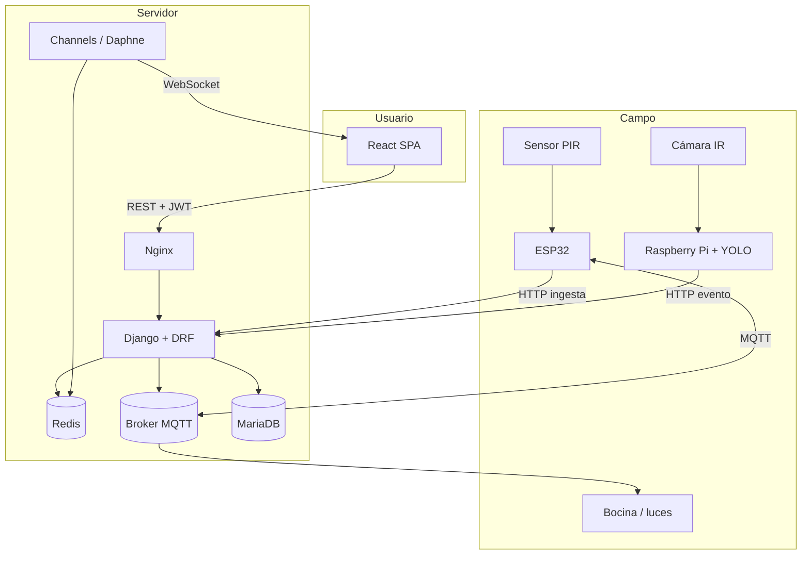
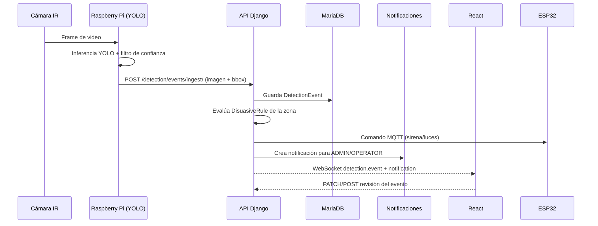

# Arquitectura de SIAAC

## Visión general

SIAAC se organiza en cuatro capas:

1. **Campo (hardware):** ESP32 con PIR, bocina y luces; Raspberry Pi con cámara IR
   y modelo YOLO; fuente y relés.
2. **API (Django + DRF):** autenticación JWT, reglas de negocio, persistencia,
   generación de reportes e integración MQTT.
3. **Tiempo real (Channels + Redis):** difusión de lecturas, detecciones y
   notificaciones por WebSocket.
4. **Presentación (React):** tableros, monitoreo, supervisión y configuración.



## Flujo de detección y respuesta



## Decisiones de diseño

| Decisión | Motivo |
| --- | --- |
| App Django por módulo | Bajo acoplamiento y despliegue/equipo por módulo. |
| JWT con refresh rotativo | Sesiones stateless y revocables; auditoría en `sesiones_usuario`. |
| WebSocket con Channels + Redis | Escalado horizontal del monitoreo en vivo. |
| Ingesta con `X-Device-Key` | Autenticación simple para ESP32/Raspberry sin usuario humano. |
| MQTT para actuadores | Baja latencia y desacoplamiento del backend. |
| YOLO en la Raspberry Pi | Reduce ancho de banda: solo se envían eventos e imágenes. |
| Reportes PDF/CSV | Entrega directa a operadores y auditoría. |
| Borrado lógico en zonas | Conserva historial de eventos y reportes. |

## Estructura de una app Django

Cada módulo sigue el mismo patrón:

```
apps/<modulo>/
├── apps.py          # configuración y verbose_name
├── models.py        # entidades y relaciones
├── serializers.py   # validación / contrato de API
├── views.py         # ViewSets y endpoints de acción
├── urls.py          # router del módulo
├── admin.py         # administración
├── services.py      # lógica externa (MQTT, reportes, notificaciones)
├── consumers.py     # WebSocket (monitoring / notifications)
├── routing.py       # rutas WebSocket
├── signals.py       # eventos automáticos (detection)
├── migrations/
└── tests/
```

## Seguridad

- Contraseñas con PBKDF2 (Django) y validadores configurados.
- Roles `ADMIN`, `OPERATOR`, `VIEWER` verificados en permisos DRF.
- Refresh tokens rotativos y blacklist (`token_blacklist`).
- CORS restringido por variable de entorno.
- API keys por dispositivo; rotables desde el admin.
- En producción: HTTPS, HSTS, cookies seguras y `DEBUG=False`.
- Validación de imágenes y límite de tamaño en Nginx (`client_max_body_size`).

## Escalabilidad

- Backend sin estado: N réplicas detrás de Nginx.
- Redis para Channels y caché.
- MariaDB con índices por fecha/zona en lecturas y eventos.
- La inferencia puede moverse al servidor cambiando `YOLO_DEVICE`/configuración
  del servicio de la Raspberry Pi.
- Retención recomendada: lecturas crudas 90 días, eventos e imágenes 1 año,
  reportes 5 años (según normativa aplicable).
